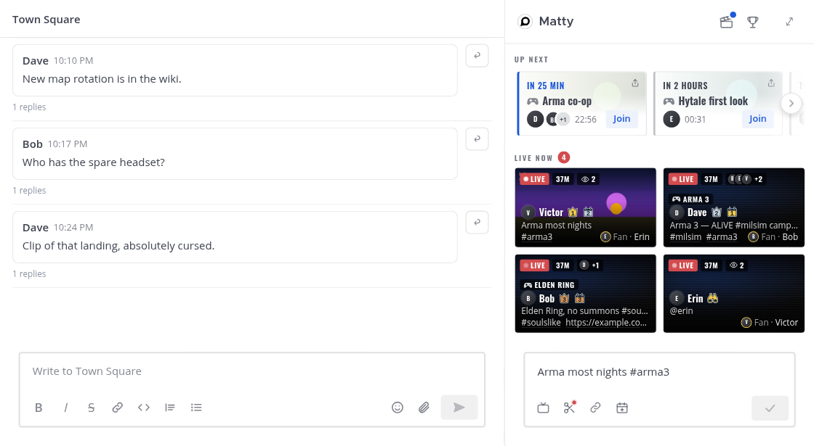

  

<h1 align="center">Matty Plugin</h1>

The companion plugin of Matty, the Android app for Mattermost. Your own Broadcast Box's live streams, in a panel beside chat.

  <a href="https://github.com/vvilla-01/matty-plugin/releases">Download</a> · <a href="docs/install.md">Installing</a> · <a href="docs/upgrading.md">Upgrading</a> · <a href="docs/README.md">Manual</a>

 

  

 

<h3 align="center">Every stream in one panel</h3>

Each live stream is a card. Watch one, or up to four at once.

 

<h3 align="center">Unlocked with your token</h3>

Locked for everybody, admins too. Your stream token opens it.

 

<h3 align="center">Clips, plans and medals</h3>

Clip a moment and share it. Say what is up next. Hours on air count toward medals.

 

<h3 align="center">Voice and games</h3>

Mumble, talking in its channels from Matty, a soundboard, Twitch and Steam. Each off until an admin turns it on.

 

<h3 align="center">Made for Matty</h3>

The panel's API is a written contract, and Matty is built to it. Releases are signed with Matty's own keys, and the server can check a phone's Matty in turn, and turn away a Matty older than the one it needs. With <a href="docs/push.md">push notifications</a> on, Matty notifies through a UnifiedPush app without staying connected. With <a href="docs/updates.md">Look for updates</a> on, system admins hear of a new release and install it from the System Console or from Matty.

 

<h3 align="center">Get Matty Plugin</h3>

Download the bundle from <a href="https://github.com/vvilla-01/matty-plugin/releases">Releases</a>: Mattermost 11.11.0 or later, Linux amd64. Upload it in the System Console, under Plugins, and enable it. Then set the Broadcast Box URL on its settings page, under Matty.

 

<h3 align="center">Read more</h3>

<a href="docs/README.md">Manual</a> · <a href="docs/install.md">Installing</a> · <a href="docs/upgrading.md">Upgrading</a> · <a href="docs/push.md">Push notifications</a> · <a href="docs/security.md">Security</a> · <a href="LOCKDOWN.md">Lockdown</a> · <a href="contract/README.md">Client contract</a>

Settings help: <a href="docs/awards.md#airtime-and-medals">Airtime and medals</a> · <a href="docs/awards.md#top-snoopers">Top Snoopers</a> · <a href="docs/up-next.md#the-twitch-application">The Twitch application</a> · <a href="docs/voice.md#mumble-chat-in-the-same-channel">Mumble chat</a>

 

Matty Plugin is not affiliated with Mattermost, Inc. Public domain, under <a href="LICENSE">The Unlicense</a>.

